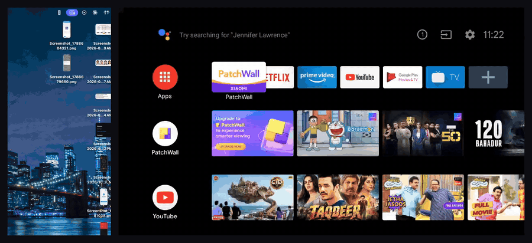
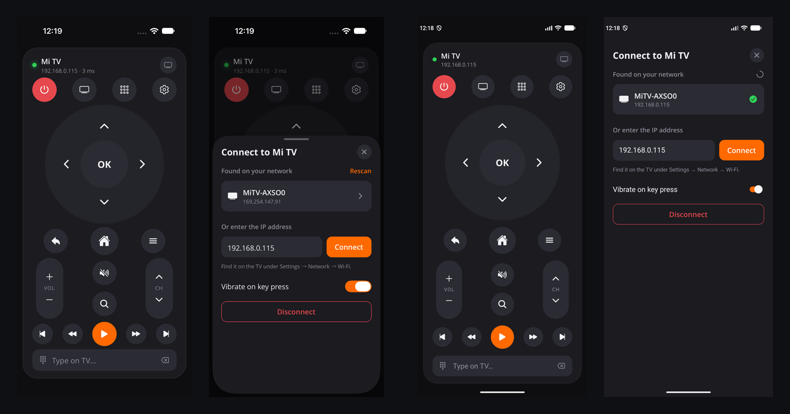

# Mi TV Remote

Remote control apps for Xiaomi Mi TV (Android TV / PatchWall) on **macOS**, **Android** and **iOS**. They control the TV over Wi-Fi with no ADB, using a remote service built into the TV: Xiaomi's **MiLink**, with no pairing needed, or, on models without it, Google's **Android TV remote service** after a one-time pairing code.

MiLink's protocol isn't documented, so it was **reverse engineered with [REA (Reverse Engineer Anything)](https://github.com/morluto/rea)** from the TV's own firmware (see [How it was reverse engineered](#how-it-was-reverse-engineered)).



*The macOS app opened from the menu bar (left) and the TV screen, recorded at the same time over ADB (right).* [Watch the MP4](docs/demo.mp4)

> Not affiliated with or endorsed by Xiaomi. "Mi" and "Xiaomi" are trademarks of their respective owners.

## Apps

| App | Folder | Built with | Output |
|---|---|---|---|
| macOS | [`apps/macos`](apps/macos) | Swift, SwiftUI, Network framework | Menu bar app (universal DMG) |
| Android | [`apps/mobile`](apps/mobile) | React Native (Expo), Kotlin native module | APK |
| iOS | [`apps/mobile`](apps/mobile) | React Native (Expo), Swift native module | Unsigned IPA for sideloading |



*The iOS app (left: remote and TV picker) and the Android app (right), in the simulator and emulator, connected to a mock MiLink TV.*

All three implement the same protocols and features:

- **Works with more Mi TVs**: MiLink where the TV has it, otherwise the Android TV remote service, with a one-time pairing code shown on the TV. The apps pick the right one and remember it per TV.
- **Full remote layout**: power, input source, recent apps, TV settings, D-pad and OK, back, home, menu, volume, mute, search, channel up and down, and media controls. Over the Android TV remote service, input source and recent apps work differently (see [Compatibility](#compatibility)).
- **Hold to repeat** on the D-pad, volume and channel keys.
- **Type on the TV**: send text to search boxes and login fields.
- **Auto-discovery** of Mi TVs on the network, or enter the IP address by hand. See [Compatibility](#compatibility) for supported models.
- **Auto-reconnect**, with heartbeats, and a live latency readout over MiLink.
- **macOS**: lives in the menu bar and has keyboard shortcuts ([list](apps/macos/README.md#keyboard-shortcuts)).
- **Mobile**: haptic feedback, and the remote reconnects when you return to the app.

## Compatibility

| TV | Status |
|---|---|
| **Xiaomi Mi TV `MiTV-AXSO0`** (Android TV 9, PatchWall) | ✅ Tested with the macOS app. The mobile apps use the same protocol and have so far been tested against a mock TV |
| **Xiaomi Mi TV `MiTV-MOOR2`** (Android TV 11, no MiLink) | ✅ Tested with the macOS app, through the Android TV remote service ([#4](https://github.com/EndLess728/MiTV-Remote/issues/4)): pairing, navigation, volume, media keys and typing work. Input source opens Settings; recent apps isn't available |
| Other Mi TVs on Android TV with PatchWall | Expected to work, not tested |
| Xiaomi TVs on Google TV | Expected to work through the Android TV remote service, not tested |

The apps don't depend on a specific model. They talk to one of two services on the TV:

- **MiLink** (`com.mitv.milinkservice`, **TCP port 6091**), the service Xiaomi's own phone remote apps use. No pairing needed. Supported by all apps.
- **Android TV Remote** (**TLS ports 6466 and 6467**), the service Google's TV remote app uses, present on most Android TV and Google TV models. Needs a one-time pairing: the TV shows a 6-character code, and you type it into the app. Supported by all apps.

The apps try MiLink first and fall back to the Android TV remote service, and remember which one each TV uses.

**Over the Android TV remote service**, the TV only acts on a limited set of keys, the same ones the Google TV app can send:

- **Input source**: there's no input key, so the button opens the TV's **Settings**, where the inputs are. (Tried on the MOOR2: TV, HDMI 1–4, Guide and F1–F12 keys don't open the input menu.)
- **Recent apps**: not available; the button is greyed out.
- **macOS**: the pairing key is kept in your login keychain. After installing a new version, macOS may ask once for your password to let Mi Remote use it; choose **Always Allow** to keep the pairing.

**Check your TV** (it must be on the same Wi-Fi as your computer):

```sh
TV=<tv-ip>
ping -c 1 -W 2 "$TV" >/dev/null && echo "TV reachable" || echo "TV not reachable: check the IP and that you're on the same network"
for p in 6091 6095 6466; do
  nc -z -w 3 "$TV" "$p" && echo "port $p open" || echo "port $p closed"
done
```

Find the TV's IP under **Settings → Network → Wi-Fi** on the TV.

- **Port 6091 open**: the TV runs MiLink and every Mi Remote app should work.
- **Port 6091 closed, 6466 open**: the TV has no MiLink but has the Android TV remote service, so the apps can control it after pairing.
- **Both closed** (and the TV is reachable): the apps can't control this TV yet. Port **6095** (Xiaomi's older HTTP remote) isn't used by the apps; whether it's open helps judge what such a TV could support, so please include the full output when you open an issue.

If you try a model not listed here, please open an issue with the model (usually under **Settings → Device Preferences → About**), its Android TV version, the output above and whether it worked, so the table can grow.

## Install

Download the files from the latest [**Release**](../../releases/latest).

### macOS (14 Sonoma or later)

1. Open `Mi-Remote-x.y.z-macOS.dmg` and drag **Mi Remote** to **Applications**.
2. The app is not notarized by Apple, so macOS blocks it the first time. Open it once, click **Done**, then go to **System Settings → Privacy & Security** and click **Open Anyway**. Or run:
   ```sh
   xattr -dr com.apple.quarantine "/Applications/Mi Remote.app"
   ```
3. Allow **Local Network** access, then click the remote icon in the menu bar.

### Android (7.0 or later)

1. Download `Mi-Remote-x.y.z-android.apk` on the phone and open it.
2. Allow installing apps from your browser or file manager when Android asks, then tap **Install**.

### iPhone (iOS 16.4 or later), without a developer account

The IPA is unsigned. A sideloading tool signs it with your own Apple ID as it installs it. A free Apple ID works, with Apple's limits: the app must be refreshed every 7 days, and you can have up to 3 sideloaded apps.

**Sideloadly** (simplest, needs a Mac or Windows PC):

1. Install [Sideloadly](https://sideloadly.io) and connect the iPhone by USB (tap **Trust** on the phone).
2. Drag `Mi-Remote-x.y.z-ios-unsigned.ipa` into Sideloadly, enter your Apple ID, and click **Start**.
3. On the iPhone, enable **Settings → Privacy & Security → Developer Mode** (iOS 16+) and restart when asked.
4. Go to **Settings → General → VPN & Device Management**, tap your Apple ID and **Trust** it.
5. Open **Mi Remote** and allow **Local Network** access.

**AltStore / SideStore** (can refresh on the phone): install [AltStore](https://altstore.io) or [SideStore](https://sidestore.io), then in its **My Apps** tab tap **+** and pick the IPA. They can refresh the 7-day signature automatically.

## Build from source

### macOS

Needs Xcode 16 or later.

```sh
cd apps/macos
./build-app.sh               # native build -> dist/Mi Remote.app
UNIVERSAL=1 ./build-app.sh   # arm64 + x86_64
```

### Android and iOS

Needs Node 22 and Yarn 1. Android needs JDK 17 and the Android SDK; iOS needs Xcode and CocoaPods.

```sh
cd apps/mobile
yarn install
yarn android:production      # build and run on a connected device or emulator
yarn ios:production          # build and run in the iOS simulator
```

See [`apps/mobile/README.md`](apps/mobile/README.md) for the project layout and development workflow.

### CI and releases

[`.github/workflows/build.yml`](.github/workflows/build.yml) builds all three apps on every push and pull request and attaches the DMG, APK and IPA to the workflow run. The macOS job first runs the Swift tests, including an end-to-end test against a stand-in Android TV ([`apps/macos/Tests/fake_tv.py`](apps/macos/Tests/fake_tv.py)): TLS 1.2 only, client certificates required, and the real pairing protocol. **Every push to `main`** (a merged pull request or a direct commit) publishes a GitHub Release with all three apps and a changelog. The version follows the commit messages since the last release ([Conventional Commits](https://www.conventionalcommits.org/)): a `feat` makes it a minor release (1.2.0 → 1.3.0), a `!` (`feat!:`) or a `BREAKING CHANGE:` footer a major one, and anything else a patch (1.2.0 → 1.2.1). Pull requests are built but not released.

To pick the version yourself, push a tag instead:

```sh
git tag v1.1.0 && git push origin v1.1.0
```

Or run the workflow from **Actions → Build → Run workflow**, tick **release** and enter a version; it creates the tag itself. A version with a suffix, such as `1.2.0-alpha.1`, is published as a **pre-release**, so a feature branch can be tested before it's merged. Every release includes all three apps; for a quick Mac-only test build, tick **macos_only**.

No secrets are needed. The macOS app is ad-hoc signed, the APK uses the standard debug signing key, and the IPA is unsigned so that each person signs it with their own Apple ID.

## How it works

Mi TVs ship a system service, **MiLink** (`com.mitv.milinkservice`), that listens on **TCP port 6091**. It's what Xiaomi's own phone remote apps use. The service accepts Android key events and injects them on the TV with `Instrumentation.sendKeySync()`.

All fields are big-endian:

```
frame       = type:u8  length:u16  payload[length]
type 2      = heartbeat (empty payload), sent every 5 s
type 4      = send key
  payload   = code:u8 (1 = send, 2 = response)  id:u32  len:u16  data[len]
  data      = TLVs (tag:u8 value):
                1 metaState   i32     5 repeatCount  i32
                2 action      i32     6 flags        i32
                  (0 down, 1 up)      7 downTime     i64
                3 keyCode     i32     8 eventTime    i64
                4 scanCode    i32    10 deviceId     i32  (-1 = virtual keyboard)
                                     11 source       i32  (0x101 = keyboard)
```

The TV answers each key with a type 4 response (`code = 2`) that carries the same `id`. The apps use it to show latency.

Implementation notes:

- **`downTime` and `eventTime` must be 0.** The TV then stamps the event with its own uptime clock. Sending the device's clock puts events "in the future" on the TV and can stall its input dispatcher until that time arrives. This was the hardest bug to find.
- **Holding a key**: the TV releases a key on its own about 175 ms after the last DOWN, so held buttons resend DOWN every 100 ms with an increasing `repeatCount`, then send UP.
- **Text**: MiLink has no text packet, so typing maps each character to an Android key code (plus Shift) and sends it as a keystroke.
- **Discovery**: Mi TVs advertise `_googlecast._tcp` with a TXT `md=MiTV-…` model, which the apps browse and resolve to an IPv4 address.

### Android TV Remote

Mi TVs without MiLink usually still run Google's **Android TV Remote Service**, the one the Google TV app talks to (protocol v2). Both ports use **TLS 1.2** (the service is a Netty TLS 1.2 server; the apps pin 1.2, as Apple's TLS 1.3 handshake fails against it), and both require a client certificate. Messages are protobuf, each prefixed with its length as a varint.

- **Pairing, port 6467.** The app sends a pairing request, then options and configuration (6-digit hex code, the app as input). The TV then shows a code. The secret is `SHA-256(client modulus, client exponent, TV modulus, TV exponent, last 2 bytes of the code)`. The code's first byte must equal the hash's first byte, which catches typos before anything is sent. Once the TV acks the secret, it trusts the app's certificate permanently.
- **Remote, port 6466.** The TV opens with a `RemoteConfigure` and the app answers with the features it wants; the TV pings every 5 seconds and the app echoes each ping. Keys are `RemoteKeyInject` messages with Android key codes, and text goes into the focused field with `RemoteImeBatchEdit`. Only some key codes are acted on (see [Compatibility](#compatibility)). If the TV drops the TLS session before configuring, the certificate isn't paired and the app starts pairing. The apps connect plain TCP first and only then TLS, because a rejected or stalled handshake can look like a reset or timeout, which would otherwise read as "nothing listening".
- **The client certificate.** Each app generates a 2048-bit RSA key and keeps it: in the keychain on iOS and macOS, in app storage on Android. The certificate is kept as a file next to the app's data and joined with the key into the TLS identity when connecting (on macOS a keychain label lookup of it came back empty, so the app sent no certificate and the TV refused to pair). The self-signed X.509 certificate is built by the app itself ([`src/atv/der.ts`](apps/mobile/src/atv/der.ts), [`ATVProtocol.swift`](apps/macos/Sources/MiRemote/ATVProtocol.swift)), because Apple's platforms have no API for creating certificates. The macOS app is ad-hoc signed, so after an update macOS may ask once whether it can use its keychain key; **Always Allow** keeps the pairing.

The message layouts follow [androidtvremote2](https://github.com/tronikos/androidtvremote2), the library behind Home Assistant's Android TV Remote integration. The unit tests check against bytes and secrets that library produces.

Where it lives:

| | macOS | Android / iOS |
|---|---|---|
| MiLink protocol | [`RemoteClient.swift`](apps/macos/Sources/MiRemote/RemoteClient.swift) | [`src/milink`](apps/mobile/src/milink) (TypeScript, unit tested) |
| Android TV Remote protocol | [`ATVProtocol.swift`](apps/macos/Sources/MiRemote/ATVProtocol.swift) (unit tested) | [`src/atv`](apps/mobile/src/atv) (TypeScript, unit tested) |
| Connection, protocol choice, pairing | `RemoteClient.swift` | [`src/remote/client.ts`](apps/mobile/src/remote/client.ts) |
| TCP / TLS socket, client key | Network framework | [`modules/milink`](apps/mobile/modules/milink): Swift (iOS) and Kotlin (Android) |
| Discovery | [`TVDiscovery.swift`](apps/macos/Sources/MiRemote/TVDiscovery.swift) | Same native module: `NWBrowser` (iOS) and `NsdManager` (Android) |

## How it was reverse engineered

The protocol was recovered from the TV itself using **[REA](https://github.com/morluto/rea)**, an MCP server for reverse engineering binaries, apps and runtime behavior, driven by an AI agent:

1. **Device recon**: with ADB over Wi-Fi enabled on the TV, REA inspected the device and listed its packages, which pointed to the MiLink service.
2. **Extraction**: REA pulled the `com.mitv.milinkservice` APK off the TV.
3. **Static analysis**: REA searched and decompiled the Android classes to find the remote-control server (`RCServerThread`) and its packet classes (`SendKeyPacket`, `SendKeyHeader`, `SendKeyData`, `SendKeyHandler`), which gave the frame layout, TLV tags and key-injection path.
4. **Runtime verification**: a small test client sent packets to port 6091 while the TV's `logcat` was watched. The service logs every parsed TLV field and `Send key success`, which confirmed each field and exposed the timestamp problem.

The macOS app was written from the confirmed protocol, and the mobile apps port the same implementation.

## Disclaimer

This is an independent interoperability project for controlling a TV you own on your own network. It uses only the TV's existing network remote service and does not modify the TV. Use it at your own risk.
